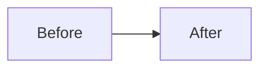

## Summary

<!-- One or two sentences: what this PR does. -->

## Why

Closes #

<!-- One issue per PR. Say why the change is needed if the issue doesn't. -->

## What changed

<!-- The main changes, grouped by area. -->

## Architecture

<!-- Required when the change touches a flow, a structure or the schema: add a Mermaid diagram.
     Otherwise write "Not applicable". -->

## Screenshots

<!-- Before and after for anything visual: phone and desktop, light and dark.
     Otherwise write "Not applicable". -->

## How to test

1.

## Evidence

<!-- Output of typecheck, lint and tests, or a short recording. Paste the result, not "passes". -->

## Not verified

<!-- What you did not run or check (for example Android, real device, dark mode). Write "Nothing" only if true. -->

## Risk and rollback

<!-- What could break, who is affected, and how to undo it. For a migration, say how to reverse it. -->

## Checklist

- [ ] `npm run typecheck` and lint pass
- [ ] Database changed: new migration, safe to re-run, and `python3 -I supabase/tests/rls_check.py` passes
- [ ] One issue per PR, under about 400 changed lines where possible
- [ ] No secrets, passwords or personal data
