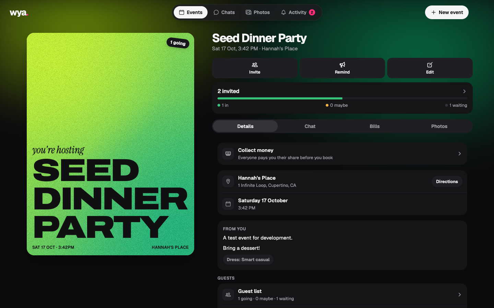
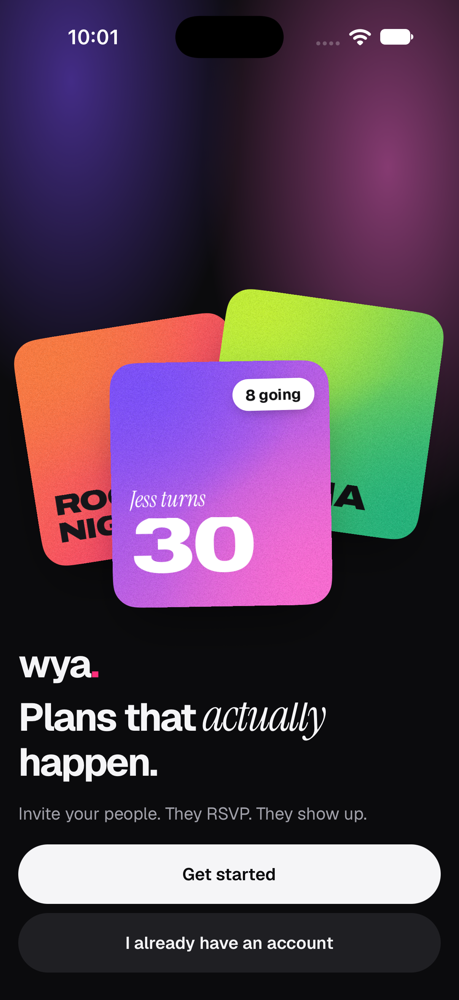
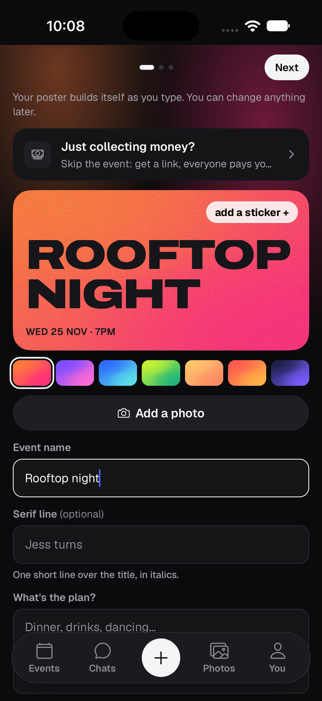
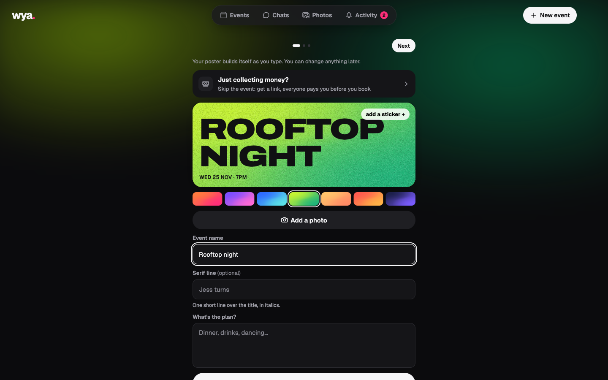
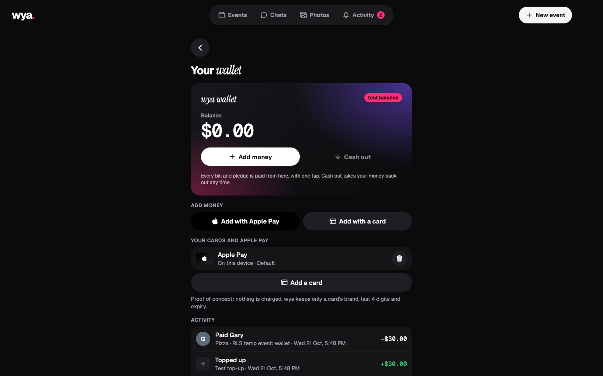
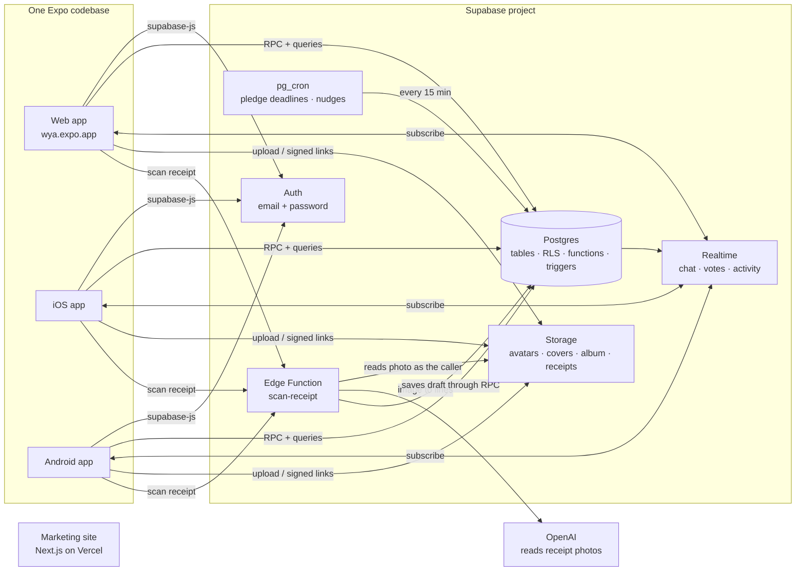
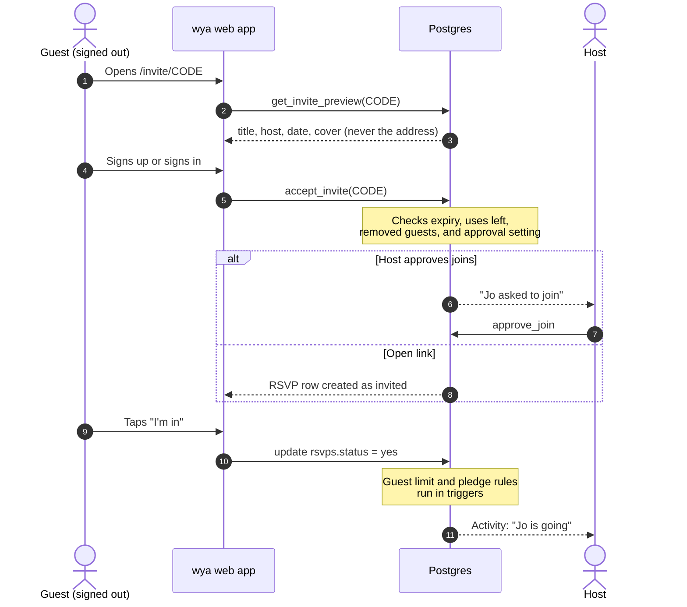
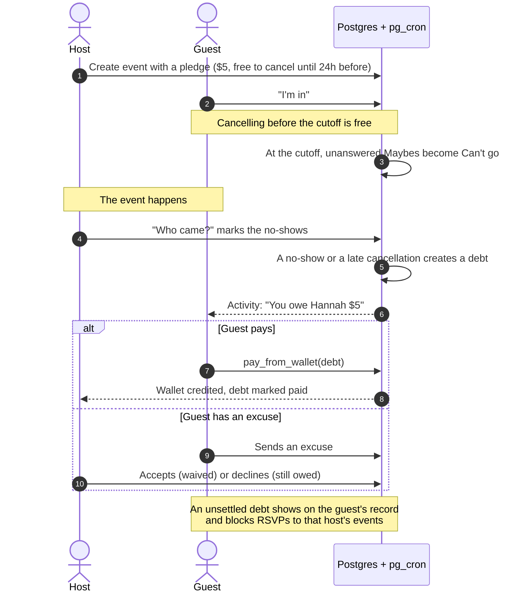
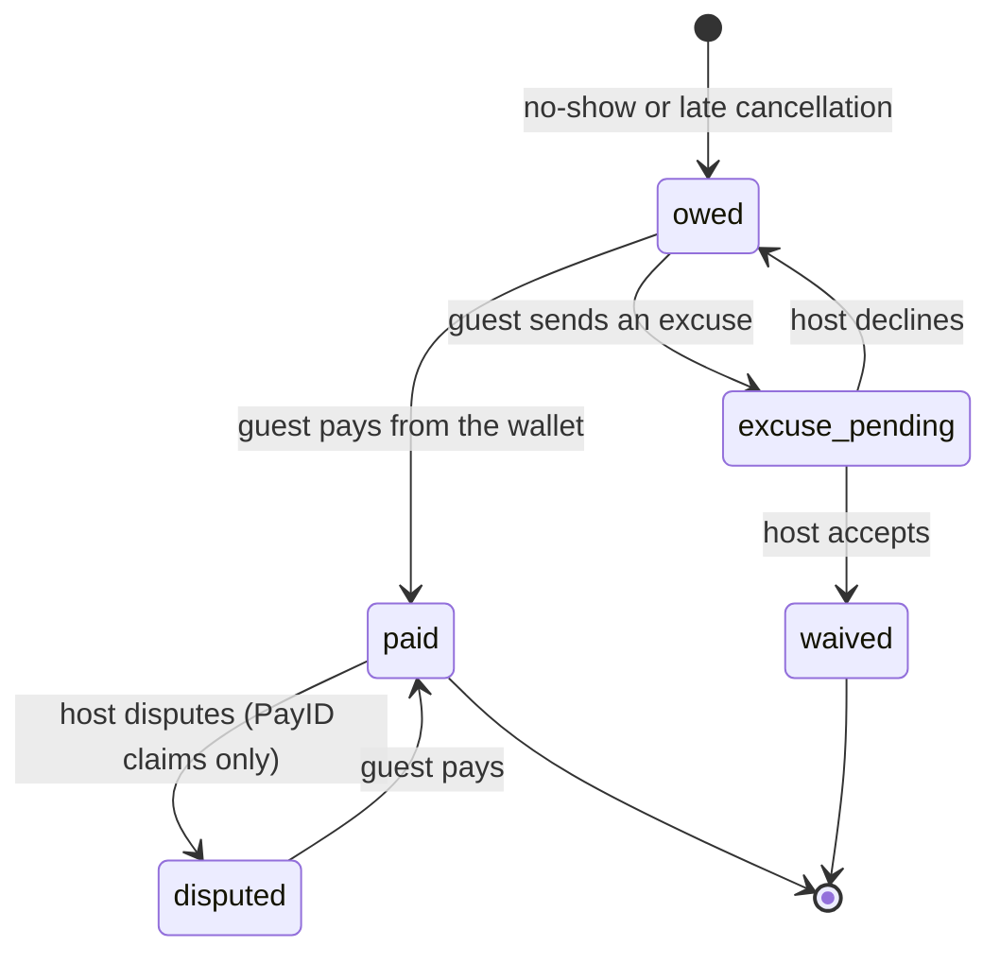
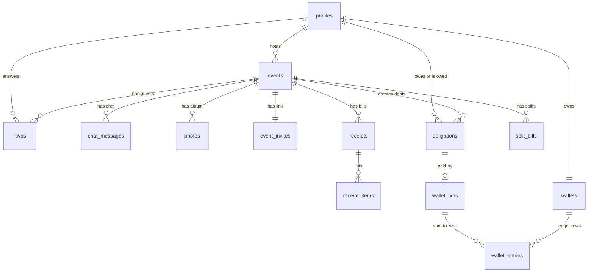

<div align="center">

# wya

**Plans that actually happen.**

An RSVP app where "I'm in" is a promise. If you say you're coming and you don't show up, you owe the host.


[Live app](https://wya.expo.app) · [Features](docs/FEATURES.md) · [Roadmap](#roadmap) · [Contributing](#contributing)



</div>

---

## Contents

- [Why wya exists](#why-wya-exists)
- [What you can do with it](#what-you-can-do-with-it)
- [Screenshots](#screenshots)
- [How it works](#how-it-works)
- [Tech stack](#tech-stack)
- [Getting started](#getting-started)
- [Running the tests](#running-the-tests)
- [Project layout](#project-layout)
- [The database](#the-database)
- [Security model](#security-model)
- [Documentation](#documentation)
- [Roadmap](#roadmap)
- [Contributing](#contributing)
- [Security reports](#security-reports)
- [License](#license)

---

## Why wya exists

Hosts over-prepare. You invite thirty people, cook for thirty, and ten turn up. Group chats and "interested" buttons don't change that, because saying yes costs nothing.

wya makes an RSVP mean something. When you tap **I'm in** on an event that has a pledge, you agree to a small amount (the default is $5 AUD) that you owe the host if you don't show up. If you come, or cancel in time, nothing happens. If you flake without an excuse the host accepts, you owe them.

The pledge is the core idea. Everything else in the app (invites, the guest list, chat, the photo album, bill splitting) exists to make the event easy to organise and the commitment easy to keep.

wya starts in Australia. It is pre-launch. There are no real users yet, and the database is a shared development project.

## What you can do with it

**Host an event**
- Create an event with a poster-style cover that builds itself as you type, or add your own photo.
- Share an invite link that opens in any browser. Guests see a preview (title, host, date, cover) before they sign in. They never see the address until they are on the guest list.
- Set a guest limit, an expiry on the link, a limit on how many times it can be used, and whether new people need your approval.
- Run "find a time" polls on open events, then lock one in.
- Mark who actually came, and see each guest's track record ("came to 9 of 10").

**Be a guest**
- Say "I'm in", "Maybe" or "Can't go", with a note for the host.
- Chat with the group. Type `/` for commands such as `/poll`, `/plan`, `/split`, `/bill` and `/here`.
- Check in with `/here` when you arrive.
- Share photos in the event album once you're going.

**Handle the money**
- Pledges: if you flake, pay the host from your in-app wallet in one tap, or send them an excuse.
- Bill splitting: scan a receipt, tick what you had, and wya works out who owes what.
- Collect before you book: an organiser asks for a fixed amount from each person up front, so a booking has money behind it before anyone commits.

The wallet currently runs on a test balance. No real money moves yet. Real payments need a licensed payments partner (see the [roadmap](#roadmap)).

Full feature status, including what is live, in progress, planned and decided against, is in [docs/FEATURES.md](docs/FEATURES.md).

## Screenshots

### On the phone

<table>
  <tr>
    <td align="center"><br><sub>Welcome</sub></td>
    <td align="center"><br><sub>Create an event</sub></td>
    <td align="center"><br><sub>The event page</sub></td>
    <td align="center"><br><sub>The wallet (test balance)</sub></td>
  </tr>
</table>

### On the web

<table>
  <tr>
    <td align="center"><br><sub>Create an event</sub></td>
    <td align="center"><br><sub>The wallet (test balance)</sub></td>
  </tr>
</table>

The phone screenshots come straight from the iOS simulator (iPhone 18 Pro, iOS 27). The web screenshots come from the web app in a 1440px browser window. All of them show dark mode and use fictional seed data from `supabase/seed.sql`.

## How it works

### System architecture

wya has no server of its own. One Expo codebase builds the web, iOS and Android apps. Those talk straight to Supabase, where the rules live in the database itself.



The client never decides what is allowed. Row-level security (RLS) policies and `security definer` functions in Postgres decide who can read and change what, and the app only calls those functions.

### From invite link to RSVP

Most guests first meet wya through a link, often before they have an account.



### The pledge flow



A debt moves through a small set of states. The database enforces every move, so a client cannot skip a step.



## Tech stack

| Layer | Choice |
|---|---|
| App | [Expo](https://expo.dev) SDK 57, React Native 0.86, React 19, TypeScript, [Expo Router](https://docs.expo.dev/router/introduction/) |
| Backend | [Supabase](https://supabase.com): Postgres with row-level security, Auth, Storage, Realtime, `pg_cron` |
| Server code | Postgres functions and triggers, plus one Deno Edge Function (`scan-receipt`) |
| AI | OpenAI, called only from the Edge Function, to read receipt photos |
| Web hosting | EAS Hosting at [wya.expo.app](https://wya.expo.app) (single-page web export) |
| Marketing site | Next.js on Vercel, in [`website/`](website/) |
| Tests | Python scripts that sign in as seed accounts and check access rules against the live database |

The web app gets the same features as the phone apps. iOS has run in the simulator and on a real iPhone. Android has not been run yet.

## Getting started

### Prerequisites

- Node.js 20.19.4 or newer (Expo SDK 57 requires it). Node 22 works well.
- npm
- Python 3, to run the database tests
- For phones, Xcode 26.4 or newer (iOS) or Android Studio with SDK 36 (Android)
- Optional: `psql` or Docker, to apply database migrations

### Set up

```bash
git clone https://github.com/aveturi14/wya.git
cd wya
cp .env.example .env
```

Open `.env` and fill in the publishable Supabase key. Ask a maintainer for it. Only publishable values go in this file, because Expo bundles everything that starts with `EXPO_PUBLIC_` into the app.

```bash
# Start everything: installs packages, applies new migrations, sets up receipt
# scanning if a key is present, then starts the web app on http://localhost:8081
npm run dev
```

Prefer to skip the extras? `npm run web` starts only the Expo web server.

> There is one shared development database, `wya-dev`, and `npm run dev` applies any new migration files to it. Check with the team before you run it from a branch that adds migrations.

### Commands

| Command | What it does |
|---|---|
| `npm run dev` | Packages, migrations, receipt-scan function, then the web app |
| `npm run web` | Expo web dev server only |
| `npm run ios` / `npm run android` | Build and run on a simulator or device |
| `npm run typecheck` | TypeScript check. Keep it at zero errors |
| `npm run db:status` | Show which migrations `wya-dev` has and which are missing |
| `npm run db:migrate` | Apply the missing migrations |
| `npm run deploy:web` | Export the web app and deploy it to production hosting |

### Seed accounts

The development database has fictional accounts for testing. Ask a maintainer for the shared password.

| Account | Role in the tests |
|---|---|
| `host@wya.test` | Hannah, hosts "Seed Dinner Party" (invite code `seedinvite`) |
| `guest@wya.test` | Gary, going to the seed party |
| `stranger@wya.test` | Sam, not invited to anything |
| `joiner@wya.test` | Jo, accepts invites during tests |

Never run `supabase/seed.sql` against a real production project.

### Native builds

`npx expo prebuild` generates the `ios/` and `android/` folders from `app.json`, and git ignores them.

```bash
npx expo prebuild --clean -p ios
LANG=en_US.UTF-8 npx expo run:ios      # CocoaPods needs a UTF-8 locale
npx expo run:android
```

Install Watchman (`brew install watchman`). Without it, Metro can stop noticing file changes.

## Running the tests

```bash
npm run typecheck                          # TypeScript

python3 -I supabase/tests/rls_check.py     # access-control tests (190 checks)
python3 -I supabase/tests/phase8/run.py    # Phase 8 feature checks
python3 -I supabase/tests/phase8/run.py --only 8.3   # one item
python3 -I supabase/tests/stress_pledges.py          # 30 guests acting at once
```

Things to know about the database tests:

- They sign in as the seed accounts and run against the live `wya-dev` project. They refuse to run against any other URL.
- Run them one at a time. They share Hannah's account and would interfere with each other.
- They restore or delete anything they change.
- Run `rls_check.py` after every database change.

Pull requests have no automated checks yet. They are on the [roadmap](#roadmap).

## Project layout

```text
app/                    Screens, using Expo Router file-based routes
  (auth)/               Welcome, sign in, register, forgot password
  (tabs)/               Events, Chats, Create, Photos, You
  event/[id].tsx        The event page: RSVP, details, guests, chat, bills, photos
  invite/[code].tsx     Public invite preview, then sign up and join
  pay/[id].tsx          Pay a debt
  receipt/[id].tsx      Itemised bill: scan, tick, confirm
  wallet.tsx            Wallet balance, cards, cash out
components/             UI kit (ui/), plus album, chat, event, pledges, receipts, wallet
hooks/                  useAuth, useTheme, useLayout, useAlbum, useObligations, ...
lib/                    Supabase client, types, payments, slash commands, upload helpers
constants/              Theme palettes and event themes
supabase/
  migrations/           The schema. This is the source of truth for the backend
  functions/            Edge Function helpers and scan-receipt
  tests/                Python access-control and feature tests
  seed.sql              Development seed data (never for production)
scripts/                dev.sh, db-migrate.sh, link-preview and brand-image tools
website/                Separate Next.js marketing site
docs/                   Product catalogue, plans, per-phase handoffs
```

## The database

The backend is the SQL in [`supabase/migrations/`](supabase/migrations/). There is no application server. Postgres functions, triggers, row-level security, Storage policies and scheduled jobs are the backend.

Apply migrations in filename order. Each one is safe to run twice. When this README and the migrations disagree, the migrations win.



Scheduled jobs run through `pg_cron`: `wya-pledge-deadlines` and `wya-nudges` every 15 minutes, and `wya-rate-limit-cleanup` daily.

## Security model

The database enforces the rules below, so a modified client cannot break them.

- **Events are private.** Only the host and people with an RSVP row can see an event. A person who has only asked to join is not a guest yet.
- **Logged-out visitors see almost nothing.** They get `get_invite_preview` and never the address.
- **The address is hidden by default.** `events.address` is not selectable. On pledge events, only the host and guests who said yes or maybe can see it. On events without a pledge, every guest can. Reads go through functions such as `get_event_addresses`.
- **Column hiding goes through functions.** Row-level security cannot hide columns, so functions do it. The host sees guest notes. Guests do not.
- **Guests can edit only their own RSVP.** They can change the status and the note, nothing else.
- **Money tables have no direct writes.** Every wallet movement goes through a function that writes two ledger rows that sum to zero, and a balance cannot go below zero. A debt can be paid once.
- **Chat clients can insert only text and images.** Cards (polls, splits, plans) and wya's own replies come from functions with restricted access.
- **Secrets never live in the app.** Keys for OpenAI and similar services go in Supabase Edge Function secrets. Nothing secret goes in `.env`, `EXPO_PUBLIC_*` variables, `app.json`, migrations or tests.
- **Rate limits** protect the writes that are easy to abuse, such as splits, receipt scans and wallet top-ups.

## Documentation

| Document | What's in it |
|---|---|
| [docs/FEATURES.md](docs/FEATURES.md) | The product catalogue: live, in progress, planned and decided against. The pledge rules, payments reasoning and decision log |
| [docs/PLAN.md](docs/PLAN.md) | Build history, technical plans and test results for each phase |
| [docs/BACKEND_SETUP.md](docs/BACKEND_SETUP.md) | Everything needed to stand up the backend from scratch |
| [docs/REBUILD.md](docs/REBUILD.md) | A specification of the backend, for rebuilding it |
| [docs/PHASE8.md](docs/PHASE8.md) | Smart coordination: polls, splits, check-in, nudges, plans, assistant. Contracts per item |
| [docs/PHASE9.md](docs/PHASE9.md) | Redesign, wallet and bills |
| [docs/PHASE5.md](docs/PHASE5.md) | Native iOS and Android notes and next steps |
| [docs/split-app/](docs/split-app/) | Product briefs and plans for collecting and splitting money |
| [CLAUDE.md](CLAUDE.md) | Handoff notes for AI coding assistants working in this repo |

## Roadmap

wya is built in phases. Done so far: phases 0 to 7, the first half of Phase 8 (polls, splits, check-in, nudges, open events, plans), the redesign, the wallet, receipt-based bills and the first collect-before-you-book stage. Remaining work, roughly in order:

- **Engineering foundations.** Continuous integration, linting, tests in CI, templates and branch rules. Tracked in [Epic: Engineering process and CI](https://github.com/aveturi14/wya/issues/23).
- **Security and money safety.** Fixes that must land before real money or users. Tracked in [Epic: Security and money safety](https://github.com/aveturi14/wya/issues/24).
- **Code quality.** Structural clean-up. Tracked in [Epic: Code quality](https://github.com/aveturi14/wya/issues/25).
- **Launch readiness.** A separate production project, account deletion, data export and monitoring. Tracked in [Epic: Launch readiness](https://github.com/aveturi14/wya/issues/26).
- **Smart coordination, remaining items.** The `@wya` assistant, venue and showtime lookups, push notifications, widgets, live location and calendar. See [docs/PHASE8.md](docs/PHASE8.md).
- **Android.** A full pass on emulators and a real device.
- **Real payments.** Top-ups and payouts through a licensed payments partner. Today the wallet is a test balance.

Open work lives in [GitHub Issues](https://github.com/aveturi14/wya/issues), grouped into two milestones: *Engineering foundations* and *Launch readiness*.

## Contributing

Everyone on the project follows the same steps.

1. **Start from an issue.** If there isn't one, open one first.
2. **Branch from `main`** as `type/issue-short-name`, for example `fix/44-duplicate-events`. Types: `feat`, `fix`, `refactor`, `docs`, `test`, `chore`, `ci`.
3. **Use [Conventional Commits](https://www.conventionalcommits.org/).** Write `type(scope): summary` in the imperative, at 72 characters or fewer.
4. **Open a pull request** that says `Closes #<issue>`. Keep it to one issue and under about 400 changed lines where you can.
5. **Show your work.** A PR should say how to test the change and what was not verified. Add a Mermaid diagram when the change touches a flow, a structure or the schema, and screenshots for anything visual.
6. **Database changes** need a new migration file (never edit an old one), written to be safe to run again, and a new check in the test scripts. Run `rls_check.py` before opening the PR.

Conventions in the code:

- Use the UI kit in `components/ui/` and the theme tokens in `constants/theme.ts`. No raw colour values in screens.
- Read the versioned [Expo SDK 57 docs](https://docs.expo.dev/versions/v57.0.0/) before using an Expo API. Things have changed from older SDKs.
- Use `lib/alert.ts` instead of `Alert.alert`, which does nothing on web.
- Write copy in plain, friendly sentence case.

A full `CONTRIBUTING.md` and the pull request template are being added; see the [process epic](https://github.com/aveturi14/wya/issues/23).

## Security reports

Please don't put credentials, personal data or vulnerability details in a public issue or pull request. A private reporting route is being set up (see the [process epic](https://github.com/aveturi14/wya/issues/23)). Until it exists, contact a maintainer directly.

wya is pre-launch and carries no support or response-time commitment.

## License

No license has been chosen yet, so all rights are reserved by default. The decision is tracked in [issue #34](https://github.com/aveturi14/wya/issues/34).
