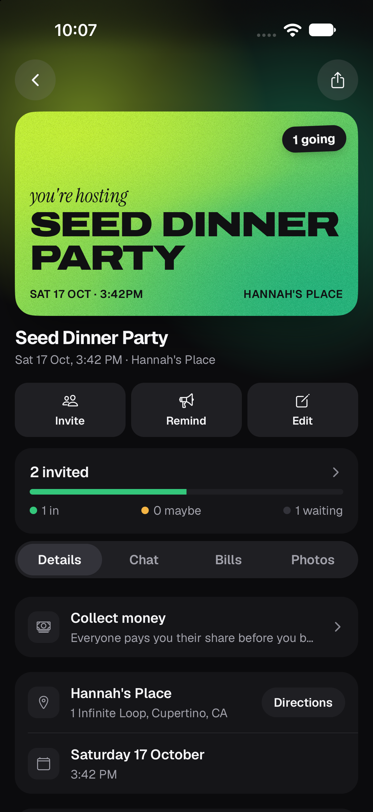
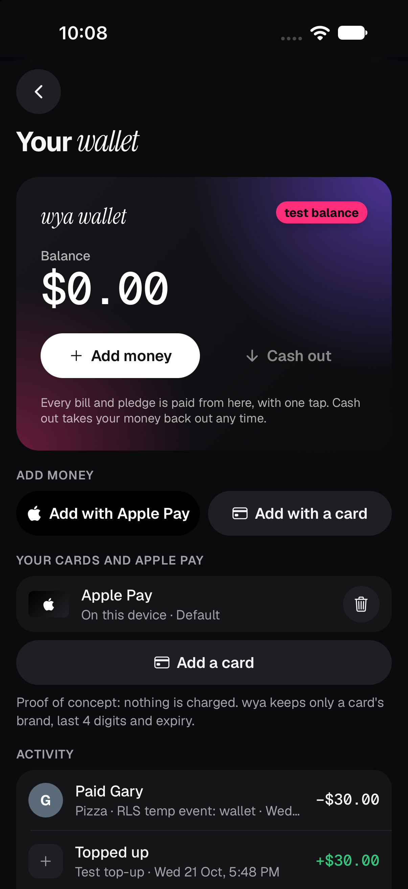
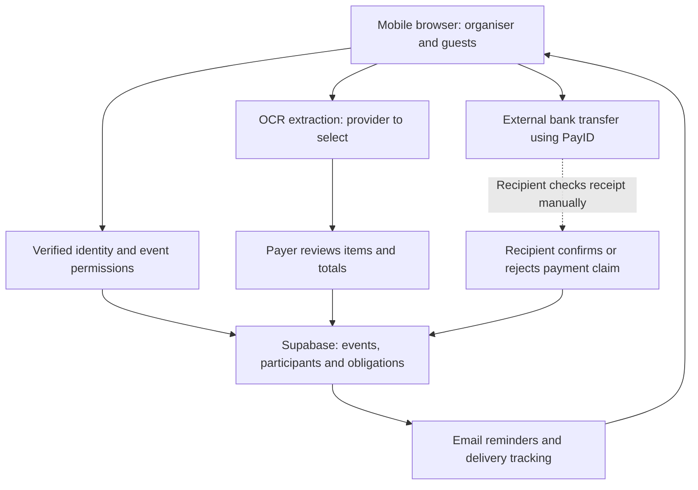
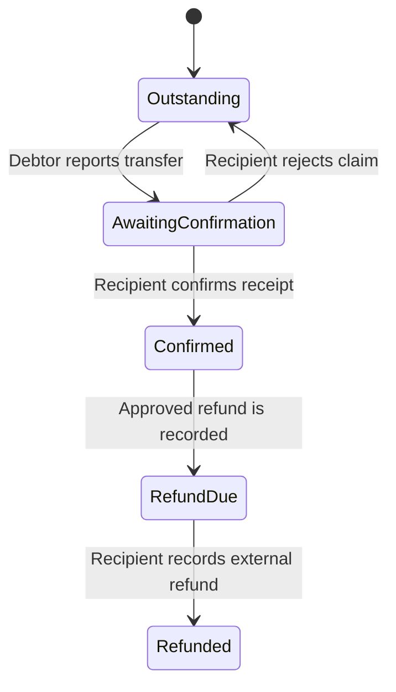
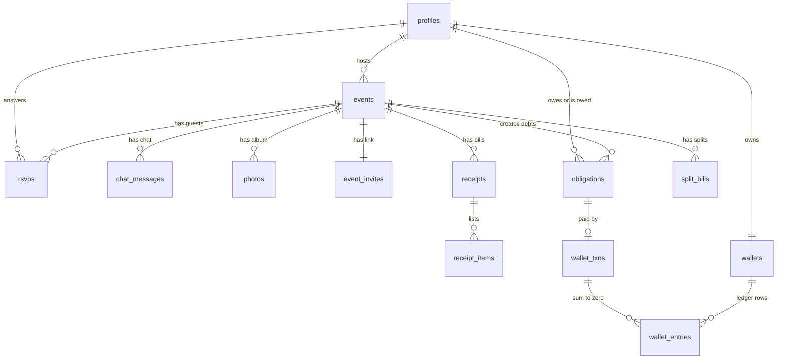
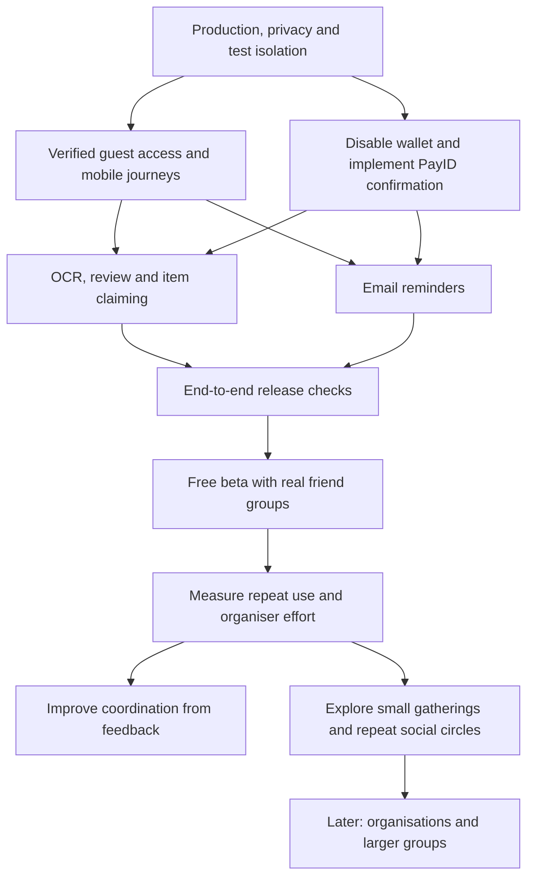

<div align="center">

# wya

**Plans that actually happen.**

Organise gatherings, coordinate commitments and settle shared costs with less chasing.

[](https://github.com/aveturi14/wya/actions/workflows/ci.yml)


[Live app](https://wya.expo.app) · [Features](docs/FEATURES.md) · [Roadmap](#roadmap) · [Contributing](#contributing)


</div>

---

## Contents

- [Why wya exists](#why-wya-exists)
- [What you can do with it](#what-you-can-do-with-it)
- [Screenshots](#screenshots)
- [How it works](#how-it-works)
- [Tech stack](#tech-stack)
- [Getting started](#getting-started)
- [Running the tests](#running-the-tests)
- [Project layout](#project-layout)
- [The database](#the-database)
- [Security model](#security-model)
- [Documentation](#documentation)
- [Roadmap](#roadmap)
- [Contributing](#contributing)
- [Security reports](#security-reports)
- [License](#license)

---

## Why wya exists

Organising a gathering should not mean repeatedly chasing RSVPs, repeating details, coordinating contributions across chats and remembering who still owes money. wya brings that work into one event, from the first invitation through the final repayment.

The first audience is people organising informal gatherings for existing friends. The first release will be **free and mobile-browser-first**, with verified guests, OCR receipt splitting and external PayID transfers. It will not require guests to download an app or set a password.

**Pre-launch:** the repository still contains the earlier pledge/test-wallet implementation and OpenAI receipt scanning. The agreed beta described here is not all implemented or deployed. The current development setup uses a shared database; production isolation and release checks remain required.

The active delivery specification is [Phase 8](docs/PHASE8.md). The work is tracked in the [free beta epic (#105)](https://github.com/aveturi14/wya/issues/105); [docs/FREE_BETA_BACKLOG.md](docs/FREE_BETA_BACKLOG.md) is the history of the issue drafts. GitHub is the live copy.

The in-app wallet was built for a hackathon demo. It is not part of the beta and may return later as a separate, licensed-partner project.

## What you can do with it

### Existing foundation and beta changes

| Area | Current implementation | Agreed beta target |
|---|---|---|
| Events | Create/edit, fixed dates or date voting, private invitations, RSVP, approval and capacity controls | Keep and verify complete mobile-browser journeys |
| Coordination | Event details, polls/chat, plans and shared photos | Keep working features; prioritise potluck/action-list improvements from feedback |
| Guest access | Public previews; participation requires an account | Verified email link/code, no password or app, stable identity and later account linking |
| Upfront contributions | PayID transfer claims with organiser confirmation | Keep; only recipient-confirmed funds count towards a booking commitment |
| Bill splitting | Equal/itemised splits; repayment UI depends on test wallet | External PayID instructions, payment reports and recipient confirmation, including standalone bills |
| Receipt extraction | OpenAI-backed scanning with manual entry | OCR, editable draft, mandatory payer review and manual fallback |
| Reminders | Activity feed and scheduled in-app nudges | Email delivery for deadlines, event changes and unpaid shares, with retry/preferences |
| Wallet and pledges | Simulated balance/card flows and no-show obligations | Disable production wallet settlement and arbitrary no-show fines |

### The first-beta experience

1. An organiser creates an event and shares an invitation through their usual chat.
2. Guests verify their email and respond in their mobile browser. No response stays distinct from an explicit decline, but is excluded from confirmed headcount after the deadline.
3. Where a booking costs money, guests see the amount and cancellation terms before committing. The recipient confirms external PayID receipts before the organiser treats places as funded.
4. After a meal, the payer uploads a receipt. OCR extracts text; deterministic parsing and total checks produce an editable draft. The payer reviews it before guests claim items and confirm shares. Manual entry is always available.
5. Each debtor pays outside wya and reports the transfer. The share stays **awaiting confirmation** until its recipient confirms receipt. Payment reminders pause while pending, resume after rejection and stop after confirmation.

Account holders and verified guests use the same financial records. Upgrading an identity must not duplicate RSVPs, item claims or obligations. Guest permissions remain event-scoped; organising and the cross-event dashboard require an account.

**Payments are external.** wya will not hold funds, charge cards, verify bank transfers automatically or execute refunds. Cancellation concerns actual previously agreed costs, with explicit refund records; it does not generate arbitrary fines. Date changes require reconfirmation.

OCR engine and processing location are **not selected yet**. Compare accuracy, mobile performance, privacy, licensing and operating cost before implementation. Free for users does not mean email, storage or OCR costs nothing.

## Screenshots

These screenshots show the existing development build. Wallet imagery is historical and is not part of the agreed beta.

### On the phone

<table>
  <tr>
    <td align="center"><br><sub>Welcome</sub></td>
    <td align="center"><br><sub>Create an event</sub></td>
    <td align="center"><br><sub>The event page</sub></td>
    <td align="center"><br><sub>The wallet (test balance)</sub></td>
  </tr>
</table>

### On the web

<table>
  <tr>
    <td align="center"><br><sub>Create an event</sub></td>
    <td align="center"><br><sub>The wallet (test balance)</sub></td>
  </tr>
</table>

The phone screenshots come straight from the iOS simulator (iPhone 18 Pro, iOS 27). The web screenshots come from the web app in a 1440px browser window. All of them show dark mode and use fictional seed data from `supabase/seed.sql`.

## How it works

### Target beta architecture

This diagram describes the agreed target, not the current deployment. The existing Expo Router / React Native / TypeScript client talks to Supabase Auth, Postgres, Storage and Realtime. Backend permissions and monetary calculations remain authoritative.



OCR may run in the browser or behind a server boundary; the choice is tracked in [#97](https://github.com/aveturi14/wya/issues/97). Receipt data must not silently fall back to ChatGPT/OpenAI. The email service is also new work. PayID transfers occur in the user's bank app, outside this architecture.

### Payment lifecycle



The recipient is the person owed money, who may differ from the event host. Reporting payment never counts as confirmed funding. Reminders to the debtor pause while awaiting confirmation; the recipient receives a task to check their bank.

Cancellation, correction and deletion must retain consistent shared financial history. This lifecycle is a target contract; the existing obligation schema and test-wallet call sites require migration.

### Current implementation references

- Public invitation previews and authenticated participation: `app/invite/[code].tsx`, `app/c/[code].tsx`.
- PayID collections: `lib/collections.ts`, `components/collect/PayIdCard.tsx`.
- Receipt drafts, claims and amounts: `lib/receipts.ts`, `components/receipts/`.
- Legacy OpenAI extraction: `supabase/functions/scan-receipt/` and `_shared/llm.ts`; replace for beta.
- Development wallet: `lib/wallet.ts`; production must reject simulated settlement as well as top-ups.
- Rules and data permissions: `supabase/migrations/`; use new migrations, never rewrite applied history.

## Tech stack

| Layer | Choice |
|---|---|
| App | [Expo](https://expo.dev) SDK 57, React Native 0.86, React 19, TypeScript, [Expo Router](https://docs.expo.dev/router/introduction/) |
| Backend | [Supabase](https://supabase.com): Postgres with row-level security, Auth, Storage, Realtime, `pg_cron` |
| Server code | Postgres functions and triggers, plus one Deno Edge Function (`scan-receipt`) |
| Receipt extraction | Current: OpenAI Edge Function. Beta target: OCR provider/location to be selected, with mandatory payer review |
| Web hosting | EAS Hosting at [wya.expo.app](https://wya.expo.app) (single-page web export) |
| Marketing site | Next.js on Vercel, in [`website/`](website/) |
| Tests | Python scripts that sign in as seed accounts and check access rules against the live database |

The shared client targets web, iOS and Android. The first beta release gate is the mobile browser, including real iPhone Safari and Android Chrome. Earlier native checks do not replace current browser acceptance.

## Getting started

### Prerequisites

- Node.js 20.19.4 or newer (Expo SDK 57 requires it). Node 22 works well.
- npm
- Python 3, to run the database tests
- For phones, Xcode 26.4 or newer (iOS) or Android Studio with SDK 36 (Android)
- Optional: `psql` or Docker, to apply database migrations

### Set up

```bash
git clone https://github.com/aveturi14/wya.git
cd wya
cp .env.example .env
```

Open `.env` and fill in the publishable Supabase key. Ask a maintainer for it. Only publishable values go in this file, because Expo bundles everything that starts with `EXPO_PUBLIC_` into the app.

```bash
# Start everything: installs packages, applies new migrations, sets up receipt
# scanning if a key is present, then starts the web app on http://localhost:8081
npm run dev
```

Prefer to skip the extras? `npm run web` starts only the Expo web server.

> There is one shared development database, `wya-dev`, and `npm run dev` applies any new migration files to it. Check with the team before you run it from a branch that adds migrations.

### Commands

| Command | What it does |
|---|---|
| `npm run dev` | Packages, migrations, receipt-scan function, then the web app |
| `npm run web` | Expo web dev server only |
| `npm run ios` / `npm run android` | Build and run on a simulator or device |
| `npm run typecheck` | TypeScript check. Keep it at zero errors |
| `npm run db:status` | Show which migrations `wya-dev` has and which are missing |
| `npm run db:migrate` | Apply the missing migrations |
| `npm run deploy:web` | Export the web app and deploy it to production hosting |

### Seed accounts

The development database has fictional accounts for testing. Ask a maintainer for the shared password.

| Account | Role in the tests |
|---|---|
| `host@wya.test` | Hannah, hosts "Seed Dinner Party" (invite code `seedinvite`) |
| `guest@wya.test` | Gary, going to the seed party |
| `stranger@wya.test` | Sam, not invited to anything |
| `joiner@wya.test` | Jo, accepts invites during tests |

Never run `supabase/seed.sql` against a real production project.

### Native builds

`npx expo prebuild` generates the `ios/` and `android/` folders from `app.json`, and git ignores them.

```bash
npx expo prebuild --clean -p ios
LANG=en_US.UTF-8 npx expo run:ios      # CocoaPods needs a UTF-8 locale
npx expo run:android
```

Install Watchman (`brew install watchman`). Without it, Metro can stop noticing file changes.

## Running the tests

```bash
npm run typecheck                          # TypeScript

python3 -I supabase/tests/rls_check.py     # access-control tests; use the current run count
python3 -I supabase/tests/phase8/run.py    # Phase 8 feature checks
python3 -I supabase/tests/phase8/run.py --only 8.3   # one item
python3 -I supabase/tests/stress_pledges.py          # 30 guests acting at once
```

Things to know about the database tests:

- They sign in as the seed accounts and run against the live `wya-dev` project. They refuse to run against any other URL.
- Run them one at a time. They share Hannah's account and would interfere with each other.
- They restore or delete anything they change.
- Run `rls_check.py` after every database change.

Every pull request runs `Typecheck` and `Lint` in GitHub Actions (`.github/workflows/ci.yml`). CI does not run the database tests yet, and there are no unit tests. Both are on the [roadmap](#roadmap).

## Project layout

```text
app/                    Screens, using Expo Router file-based routes
  (auth)/               Welcome, sign in, register, forgot password
  (tabs)/               Events, Chats, Create, Photos, You
  event/[id].tsx        The event page: RSVP, details, guests, chat, bills, photos
  invite/[code].tsx     Public invite preview, then sign up and join
  pay/[id].tsx          Pay a debt
  receipt/[id].tsx      Itemised bill: scan, tick, confirm
  wallet.tsx            Wallet balance, cards, cash out
components/             UI kit (ui/), plus album, chat, event, pledges, receipts, wallet
hooks/                  useAuth, useTheme, useLayout, useAlbum, useObligations, ...
lib/                    Supabase client, types, payments, slash commands, upload helpers
constants/              Theme palettes and event themes
supabase/
  migrations/           The schema. This is the source of truth for the backend
  functions/            Edge Function helpers and scan-receipt
  tests/                Python access-control and feature tests
  seed.sql              Development seed data (never for production)
scripts/                dev.sh, db-migrate.sh, link-preview and brand-image tools
website/                Separate Next.js marketing site
docs/                   Product catalogue, plans, per-phase handoffs
```

## The database

The backend is the SQL in [`supabase/migrations/`](supabase/migrations/). There is no application server. Postgres functions, triggers, row-level security, Storage policies and scheduled jobs are the backend.

Apply migrations in filename order. Each one is safe to run twice. When this README and the migrations disagree, the migrations win.



Scheduled jobs run through `pg_cron`: `wya-pledge-deadlines` and `wya-nudges` every 15 minutes, and `wya-rate-limit-cleanup` daily.

## Security model

The following describes the current design and intended controls, not a security certification. The verified-guest and external-settlement changes require fresh permission tests before release. See [#102](https://github.com/aveturi14/wya/issues/102).

- **Events are private.** Only the host and people with an RSVP row can see an event. A person who has only asked to join is not a guest yet.
- **Logged-out visitors see almost nothing.** They get `get_invite_preview` and never the address.
- **The address is hidden by default.** `events.address` is not selectable. On pledge events, only the host and guests who said yes or maybe can see it. On events without a pledge, every guest can. Reads go through functions such as `get_event_addresses`.
- **Column hiding goes through functions.** Row-level security cannot hide columns, so functions do it. The host sees guest notes. Guests do not.
- **Guests can edit only their own RSVP.** They can change the status and the note, nothing else.
- **Money tables have no direct client writes.** The current development wallet has ledger functions; beta disables those payment paths. External payment claims and recipient confirmation must be enforced in backend functions, not just UI labels.
- **Chat clients can insert only text and images.** Cards (polls, splits, plans) and wya's own replies come from functions with restricted access.
- **Secrets never live in the app.** Keys for OpenAI and similar services go in Supabase Edge Function secrets. Nothing secret goes in `.env`, `EXPO_PUBLIC_*` variables, `app.json`, migrations or tests.
- **Rate limits** protect the writes that are easy to abuse, such as splits, receipt scans and wallet top-ups.

## Documentation

| Document | What's in it |
|---|---|
| [docs/FEATURES.md](docs/FEATURES.md) | Historical feature catalogue; the active beta direction is in Phase 8 |
| [docs/FREE_BETA_BACKLOG.md](docs/FREE_BETA_BACKLOG.md) | History of the epic and issue drafts (published 2026-11-25); GitHub is the live copy |
| [docs/PLAN.md](docs/PLAN.md) | Build history, technical plans and test results for each phase |
| [docs/BACKEND_SETUP.md](docs/BACKEND_SETUP.md) | Everything needed to stand up the backend from scratch |
| [docs/REBUILD.md](docs/REBUILD.md) | A specification of the backend, for rebuilding it |
| [docs/PHASE8.md](docs/PHASE8.md) | Active free-beta specification, current-versus-target status, acceptance and future goals |
| [docs/PHASE9.md](docs/PHASE9.md) | Redesign, wallet and bills |
| [docs/PHASE5.md](docs/PHASE5.md) | Native iOS and Android notes and next steps |
| [docs/split-app/](docs/split-app/) | Product briefs and plans for collecting and splitting money |
| [CLAUDE.md](CLAUDE.md) | Handoff notes for AI coding assistants working in this repo |

## Roadmap

The agreed first release includes **verified guests, OCR and PayID**. A stripped-down coordination-only pilot was considered but is not the selected scope. Work is ordered by dependencies and release evidence, not a fixed launch date.



| Stage | Work and release evidence |
|---|---|
| Production foundations | Separate production/test data, fresh migrations, auth/email configuration, permissions, safe retries, monitoring, privacy/support and consistent deletion |
| Guest and financial flows | Verified email access and recovery, account linking, external PayID confirmation, cancellation/refund records and no simulated settlement |
| OCR and reminders | Measured OCR choice, payer review, manual fallback, correct item totals, mixed guest claims, delivery retries and payment-aware email reminders |
| Release checks | Real mobile Safari/Android Chrome, organiser plus verified guest plus account holder, denial-path tests, money/history consistency, deploy/rollback verification |
| Free beta | A few real organisers use wya for actual gatherings; measure response completion, manual chasing, confirmed repayments and repeat use |
| Evidence-led expansion | Improve coordination; explore newcomer-friendly small gatherings and repeat social circles; later organisations and larger groups |

The [free beta epic (#105)](https://github.com/aveturi14/wya/issues/105) holds the implementation work as sub-issues #96–#104. Existing dependencies include [production #54](https://github.com/aveturi14/wya/issues/54), [deletion/export #55](https://github.com/aveturi14/wya/issues/55), [monitoring #56](https://github.com/aveturi14/wya/issues/56), [safe create/edit #44](https://github.com/aveturi14/wya/issues/44), [financial history #41](https://github.com/aveturi14/wya/issues/41) and [test isolation #29](https://github.com/aveturi14/wya/issues/29). [Wallet #38](https://github.com/aveturi14/wya/issues/38) and [settlement #40](https://github.com/aveturi14/wya/issues/40) were rewritten for this direction, keeping their original audit fixes as acceptance criteria. [Future work #58](https://github.com/aveturi14/wya/issues/58) only has a comment; its proposed rewording is still pending in the [backlog](docs/FREE_BETA_BACKLOG.md).

### Release gate

- Production has no seed/test users or enabled simulated-money paths.
- A fresh invite survives email verification/recovery and lands on the right event on a real phone.
- Verified guests and accounts share receipt/payment records correctly, including later account linking.
- OCR failures and incorrect totals lead to review/manual entry, never silent financial obligations.
- Payment reports, recipient confirmation, rejection, reminders and manual refund records work end to end.
- Current release-path access-control and financial tests pass. Pending or skipped future-feature tests do not count as passes.
- Privacy information, support, deletion/data handling, error reporting and rollback work.

### Future direction

The social ambition is to help people new to a place join small gatherings and build repeat social circles. Public discovery is a later option requiring host supply, trust, privacy and moderation design; it is neither permanently forbidden nor part of this beta.

College committees, organisations and larger social groups come later. AI assistants, venue/showtime lookups, native push/widgets, live location, calendar integration, native-store expansion and payment processing wait for user demand. Monetisation is not a launch dependency.

## Contributing

Everyone on the project follows the same steps.

1. **Start from an issue.** If there isn't one, open one first.
2. **Branch from `main`** as `type/issue-short-name`, for example `fix/44-duplicate-events`. Types: `feat`, `fix`, `refactor`, `docs`, `test`, `chore`, `ci`.
3. **Use [Conventional Commits](https://www.conventionalcommits.org/).** Write `type(scope): summary` in the imperative, at 72 characters or fewer.
4. **Open a pull request** that says `Closes #<issue>`. Keep it to one issue and under about 400 changed lines where you can.
5. **Show your work.** A PR should say how to test the change and what was not verified. Add a Mermaid diagram when the change touches a flow, a structure or the schema, and screenshots for anything visual.
6. **Database changes** need a new migration file (never edit an old one), written to be safe to run again, and a new check in the test scripts. Run `rls_check.py` before opening the PR.

Conventions in the code:

- Use the UI kit in `components/ui/` and the theme tokens in `constants/theme.ts`. No raw colour values in screens.
- Read the versioned [Expo SDK 57 docs](https://docs.expo.dev/versions/v57.0.0/) before using an Expo API. Things have changed from older SDKs.
- Use `lib/alert.ts` instead of `Alert.alert`, which does nothing on web.
- Write copy in plain, friendly sentence case.

[CONTRIBUTING.md](CONTRIBUTING.md) has the full rules. The pull request template opens automatically when you create a PR.

## Security reports

Please don't put credentials, personal data or vulnerability details in a public issue or pull request. Follow the private reporting instructions in [SECURITY.md](SECURITY.md); verify that the route is available before launch.

wya is pre-launch and carries no support or response-time commitment.

## License

No license has been chosen yet, so all rights are reserved by default. The decision is tracked in [issue #34](https://github.com/aveturi14/wya/issues/34).
