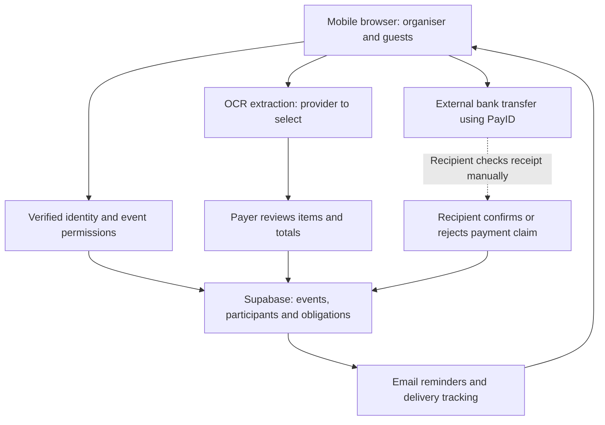
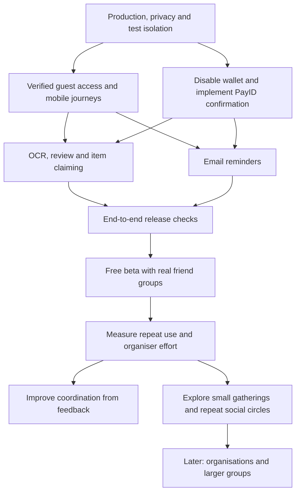

# Free beta: GitHub backlog drafts

Status: **published 2026-11-25** as epic #105 with sub-issues #96–#104 (BETA-01 to BETA-09 in order). The text below is the source the issues were created from; GitHub is now the live copy, so edit there first. Existing # references are real repository issues.

## Parent epic

**Title:** Epic: Launch the free web beta with verified guests, OCR bills and PayID

## Outcome

Launch a free, mobile-browser-first wya beta for people organising gatherings with existing friends. Guests can join through verified email without a password or app download, coordinate an event, contribute before booking through PayID, and split a receipt using OCR with human review. The organiser can see what still needs a response or payment.

Agreed product direction: 25 November 2026. This is a target specification, not a claim that these capabilities are deployed.

## Release scope

- Keep working event details, invitations, RSVP/date voting, chat, polls and photos, subject to the release checks.
- Verified guest participation, stable identity and recovery, with optional later full-account linking. Organisers have accounts; guest and account balances share the same obligation model.
- PayID transfers occur outside wya. A payment report is awaiting confirmation, never proof of receipt. Only the recipient confirms settlement.
- Keep collect-before-booking and post-event bill splitting, including a standalone bill entry point.
- Replace ChatGPT/OpenAI receipt extraction with OCR. Provider and browser-versus-server deployment remain to be evaluated. The payer reviews/corrects the extracted items and total before sharing; manual entry always works.
- Email reminders for responses, important event changes and outstanding payments. Pause debtor payment reminders while a claim awaits recipient confirmation; rejected claims become outstanding again.
- Disable wallet/card/top-up/cash-out flows and server-side simulated settlement for production. No arbitrary no-show fines.
- Costs must be agreed before commitment. Preserve recorded actual costs, payment history and manual refund tracking through cancellation.
- Preserve no-response separately from explicit decline, while excluding unanswered invitations from confirmed headcount after the deadline.
- Free for users initially. Hosting, email and OCR may still have operating costs; enforce limits and document the budget.

## Target architecture

The OCR box is a capability boundary, not a provider selection. Browser-side and server-side OCR must be compared on real receipt accuracy, mobile performance, privacy and cost. Financial amounts and permissions remain validated by the backend. wya neither holds money nor automatically verifies bank transfers.

## Delivery roadmap

## Work tracking

Implementation issues and existing foundation dependencies will be linked below. Work is ordered by dependency, not by a promised release date. The earlier coordination-only pilot is not the agreed release scope: verified guests, OCR and PayID are part of this beta.

## Release gate

- [ ] Production data is isolated from seed/test data; fresh migrations, deployment, backup/recovery and rollback are verified.
- [ ] Production wallet operations cannot create or spend simulated balances, including direct calls.
- [ ] Invite to verification to RSVP works on real mobile Safari and Android Chrome, including recovery and expired/forwarded links.
- [ ] Account holders and verified guests can share a bill without duplicate identities or balances; later linking preserves history.
- [ ] Receipt OCR -> payer review -> guest item claims -> confirmed split -> PayID payment report -> recipient confirmation works end to end.
- [ ] Manual receipt entry, failed OCR, incorrect totals, rounding and concurrent edits have tested outcomes.
- [ ] Payment claims do not count as confirmed funding; reminders pause while pending and resume after rejection.
- [ ] Cancellation/refund and account-deletion paths retain consistent shared financial records.
- [ ] Private participant data and event content are restricted by server-side rules; access-control regressions pass. Sensitive findings stay in the private security channel.
- [ ] Email delivery, retries, preferences, support, privacy information and error monitoring are operational.
- [ ] Release-path database checks and mobile browser acceptance tests pass; pending/skipped legacy tests are not counted as passes.
- [ ] A few real organisers run actual gatherings; track invite-to-response completion, manual follow-ups, confirmed repayments and repeat organising, without logging private message/receipt content.

## After beta

Use evidence before expanding: potluck contributions and organiser action lists; helping newcomers form repeat social circles through small gatherings; later college committees, organisations and larger groups. Public discovery needs a host/community supply and trust/moderation design. AI assistants, venue lookups, widgets, live location, calendar integrations, native-store expansion and payment processing are not launch dependencies.

## Documentation

README.md is the product overview. docs/PHASE8.md is the active delivery specification and decision register. Historical implementation notes must not override this scope.

## Draft work index

| Key | Work | Depends on |
|---|---|---|
| [#96](https://github.com/aveturi14/wya/issues/96) | Verified guests: email access, recovery and account linking | Production/auth configuration #54; participant access review BETA-07. |
| [#97](https://github.com/aveturi14/wya/issues/97) | OCR receipt extraction with mandatory payer review and manual fallback | BETA-01 for mixed guest acceptance; settlement #40; receipt consistency #93. |
| [#98](https://github.com/aveturi14/wya/issues/98) | Commitment deadlines, cancellation and actual-cost refund handling | Verified identities BETA-01; confirmed external settlement #40; safe create/edit #44. |
| [#99](https://github.com/aveturi14/wya/issues/99) | Mobile-browser beta journeys and reliable invite return paths | BETA-01, BETA-02, #40 and #44; production web/auth URLs #54. |
| [#100](https://github.com/aveturi14/wya/issues/100) | Email reminders for RSVP deadlines, event changes and unpaid shares | BETA-01; #40 payment states; BETA-03 deadlines; #54 email configuration. |
| [#101](https://github.com/aveturi14/wya/issues/101) | Launch acceptance, feedback and first real friend-group beta | All beta work plus #29/#30 release-path checks, #41/#42/#44, #54/#55/#56 and applicable security dependencies. |
| [#102](https://github.com/aveturi14/wya/issues/102) | Verify participant privacy and access boundaries for the free beta | #57 threat model; #88 privilege review; BETA-01 identity design. |
| [#103](https://github.com/aveturi14/wya/issues/103) | Publish beta privacy information, support and guest data controls | #55 deletion/export; #41 financial history; OCR processing choice BETA-02; #56 monitoring. |
| [#104](https://github.com/aveturi14/wya/issues/104) | Document the free beta architecture, roadmap and future product direction | Approved product scope; parent epic. |

Existing dependencies: #38 wallet isolation; #40 settlement; #41 financial history; #42 fresh migrations; #43 environment isolation; #44 atomic create/edit; #47 PayID setup; #54 production; #55 deletion/export; #56 monitoring; #57 access model; #29/#30/#80 release-path tests; #85/#87/#88/#89 applicable security hardening; #93 receipt consistency. Review #86/#95 as temporary protection for the old receipt endpoint until retired. Preserve existing parents and states; use cross-links rather than reparenting shared foundation issues.

## BETA-01

**Title:** Verified guests: email access, recovery and account linking

**Depends on:** Production/auth configuration #54; participant access review BETA-07.

## Outcome
A guest opens an invitation in a mobile browser, verifies email and participates without a password, profile setup or app installation. Organisers retain full accounts.

## Approach
Choose and document either an upgradeable authenticated guest identity or a participant record with verified account bindings. Preserve one stable identity across RSVPs, receipt claims, obligations and reminders. Reuse an existing account identity when verified; never merge by display name. The implementation must preserve backend access checks, not merely bypass the sign-in screen.

## Acceptance criteria
- [ ] New guest and existing account holder both return to the original event/collection after verification.
- [ ] Guest can RSVP, vote, see permitted details, coordinate contributions, claim receipt items, confirm shares, report payment and request a correction/cancellation/refund.
- [ ] Guest access to chat/photos follows the same event permissions as account holders; no cross-event dashboard is exposed by default.
- [ ] Verification, expiry, throttling, session recovery and link forwarding are tested; links alone do not authorize another person's financial actions.
- [ ] Upgrading/linking later preserves the participant's history, obligations and claims without duplicates.
- [ ] Existing-account collisions and different verified addresses have an explicit secure resolution path.
- [ ] Organising and cross-event account management still require an account.
- [ ] Deletion/export handling covers guest identities (#55), with no loss of other participants' financial history (#41).
- [ ] Two-device tests cover one account holder and one verified guest in the same event and bill.
## BETA-02

**Title:** OCR receipt extraction with mandatory payer review and manual fallback

**Depends on:** BETA-01 for mixed guest acceptance; settlement #40; receipt consistency #93.

## Outcome
Receipt text is extracted using OCR instead of ChatGPT/OpenAI. The payer reviews and corrects every draft before guests claim items. Bill splitting remains part of beta.

## Approach
First compare an in-browser OCR option and a server-side OCR option using representative, non-sensitive receipt fixtures. Record extraction quality, load time/memory on mobile Safari and Android Chrome, cost, licensing, supported formats and data retention. Select the engine and processing location in this issue before integration; no vendor has been selected.
Keep extraction separate from deterministic parsing, total validation, allocation and settlement. No generative-model fallback or silent invented items. Preserve a manual entry path.

## Acceptance criteria
- [ ] Record the OCR choice and measured tradeoffs with clear mobile-browser acceptance criteria.
- [ ] Receipt image -> OCR text -> editable items/quantities/adjustments -> payer review -> sharing is implemented.
- [ ] Uncertain lines and mismatched totals are visible; sharing is blocked until totals reconcile and the payer approves.
- [ ] Manual entry/correction works when OCR is unavailable, slow or incorrect.
- [ ] Quantities, discounts, tax already included, service charges and cent rounding are tested; shares sum to the confirmed total.
- [ ] Verified guests and account holders can claim items and confirm the current share.
- [ ] Image size/type limits, authentication, per-user/global limits, timeouts and privacy/retention are enforced at the relevant boundary.
- [ ] The beta receipt path no longer calls OpenAI or requires its key; old endpoints cannot remain a publicly reachable paid fallback.
- [ ] No production demo receipt fallback. Existing tests are migrated to the OCR contract, including resolution of #93.
- [ ] Reviewed bills cannot be silently changed after payment; corrections retain the financial history.
## BETA-03

**Title:** Commitment deadlines, cancellation and actual-cost refund handling

**Depends on:** Verified identities BETA-01; confirmed external settlement #40; safe create/edit #44.

## Outcome
People understand when a plan is tentative, when their place is funded and what actual cost they have agreed to. No arbitrary no-show fine is generated.

## Acceptance criteria
- [ ] Unanswered invitations remain distinguishable from explicit declines after the organiser's deadline, and are excluded from confirmed headcount.
- [ ] Events with advance purchases distinguish interest, awaiting contribution and confirmed participation.
- [ ] Confirmation for a paid commitment depends on recipient-confirmed funds, not the guest's payment claim.
- [ ] Guests see the amount, purchase deadline and cancellation/refund terms before committing.
- [ ] Unspent contributions can be recorded as refunds due; agreed non-refundable costs remain allocated after cancellation.
- [ ] Replacement participants/refunds cannot cause duplicate collection for the same cost.
- [ ] Date changes request reconfirmation and do not automatically penalise those unavailable on the new date.
- [ ] Cancellation, event deletion and participant removal preserve financial history and outstanding refund records.
- [ ] No new no-show fines or pledge-based RSVP blocks are created in beta; legacy demo obligations are isolated.
- [ ] Refund requested, refund due and refund completed are distinguishable. wya records manual refunds; it never promises to move funds.
- [ ] Tests cover before/after booking, cancellation after confirmed payment, replacement, date change and repeated requests.
## BETA-04

**Title:** Mobile-browser beta journeys and reliable invite return paths

**Depends on:** BETA-01, BETA-02, #40 and #44; production web/auth URLs #54.

## Outcome
The complete beta is usable on a phone through an invitation link, without downloading an app.

## Acceptance criteria
- [ ] Test real mobile Safari and Android Chrome, plus desktop, light/dark and narrow screens.
- [ ] Create event -> share -> preview -> verify -> join -> RSVP works, including delayed email verification and return visits.
- [ ] Expired, full, forwarded, pending and declined invitations have useful states without exposing private content.
- [ ] Date voting, event details, chat/polls and photos remain usable where enabled.
- [ ] Camera/file upload, OCR correction, item claiming, PayID copying, payment reporting and recipient confirmation work with mobile keyboards.
- [ ] Loading, network failure, retries, duplicate taps and back navigation preserve progress and do not duplicate records.
- [ ] Browser sharing fallback and production link URLs are verified.
- [ ] Wallet/card/top-up routes, no-show fine controls and unimplemented assistant promises are removed from beta navigation and deep links.
- [ ] Accessibility checks include focus, labels, readable errors and touch targets.
- [ ] Document device evidence and unresolved limitations; a desktop-width emulator alone is not mobile acceptance.
## BETA-05

**Title:** Email reminders for RSVP deadlines, event changes and unpaid shares

**Depends on:** BETA-01; #40 payment states; BETA-03 deadlines; #54 email configuration.

## Outcome
Guests and organisers receive useful updates without needing to reopen wya. Delivery works for verified guests and accounts.

## Acceptance criteria
- [ ] RSVP deadline, important date/location change and outstanding payment triggers are defined and implemented.
- [ ] A payment report pauses debtor payment reminders while awaiting recipient confirmation; recipient receives a confirmation task.
- [ ] Rejection returns the share to outstanding and resumes reminders; confirmation stops them.
- [ ] Use idempotent queued delivery with retries, throttling and delivery/failure visibility.
- [ ] Respect notification preferences and opt-out controls; document a conservative schedule before enabling delivery.
- [ ] No full receipt, sensitive payment detail or private address is unnecessarily placed in email previews/logs.
- [ ] Email links reopen the authorized event/task after verification.
- [ ] Configure authenticated sender, operating limits and failure monitoring; never claim guaranteed delivery.
- [ ] Tests prove duplicate job runs do not send duplicate reminders and settled/cancelled items stop reminders.
- [ ] Native push, SMS and automated WhatsApp sending are not beta prerequisites.
## BETA-06

**Title:** Launch acceptance, feedback and first real friend-group beta

**Depends on:** All beta work plus #29/#30 release-path checks, #41/#42/#44, #54/#55/#56 and applicable security dependencies.

## Outcome
Release a free mobile-web beta only after the agreed event, guest, OCR and PayID journeys pass. Learn from real gatherings before expanding.

## Acceptance criteria
- [ ] Record release commit, deployed migrations/configuration and passing release-path test evidence.
- [ ] Use isolated test data; pending/skipped legacy features never count as passing release checks.
- [ ] Run organiser + account holder + verified guest end to end through OCR review, claims, share confirmation, external payment report and recipient confirmation.
- [ ] Verify actual cost cancellation/refunds, identity linking, concurrent actions, no-response deadlines and email delivery.
- [ ] No production path mints/spends test money or silently uses the old OpenAI receipt flow.
- [ ] Confirm private access boundaries, deletion/data handling, support, error visibility and rollback.
- [ ] Recruit 3–5 organisers with real upcoming gatherings; do not automatically message anyone.
- [ ] Track invite-to-RSVP completion, abandoned verification, organiser manual follow-ups, confirmed repayment completion and repeat organising.
- [ ] Collect qualitative feedback without sending receipt contents, messages, addresses or personal payment data to analytics.
- [ ] Write a short post-pilot decision: fix, keep, remove or expand. No arbitrary release date or adoption claim.
- [ ] Social discovery, organisations and monetisation do not block beta.
## BETA-07

**Title:** Verify participant privacy and access boundaries for the free beta

**Depends on:** #57 threat model; #88 privilege review; BETA-01 identity design.

## Outcome
Only authorized people can access event details, participant information, receipt data and payment records, whether they use an account or verified guest access.

## Approach
Review the access matrix before beta. Handle concrete vulnerability reports and reproduction details through the private reporting route in SECURITY.md; this public issue tracks acceptance only.

## Acceptance criteria
- [ ] Define visible fields/actions for anonymous, pending, approved, declined, withdrawn, removed, host and recipient roles.
- [ ] Verify event/collection metadata, membership lists, contact fields, receipts and obligations against that matrix.
- [ ] Guest sessions and later account linking cannot broaden access or transfer financial ownership incorrectly.
- [ ] Private contact fields are exposed only where explicitly necessary.
- [ ] Authorization checks remain server-side and cover direct RPC/storage access.
- [ ] Add denial-path regression tests and verify current private findings are resolved before release.
- [ ] Logs/analytics do not capture personal tokens, addresses, receipt contents or payment references.
## BETA-08

**Title:** Publish beta privacy information, support and guest data controls

**Depends on:** #55 deletion/export; #41 financial history; OCR processing choice BETA-02; #56 monitoring.

## Outcome
Users understand what wya stores, how receipt processing works, where payments happen and how to obtain help or exercise data controls.

## Acceptance criteria
- [ ] Publish accessible privacy/product terms information and an actual monitored support route.
- [ ] Describe verified guest identity, receipt processing location/provider, retention, email and analytics accurately.
- [ ] Explain that PayID transfers and refunds happen outside wya; payment reports await recipient confirmation.
- [ ] Guest and account deletion/export paths are documented and usable (#55).
- [ ] Deletion/removal does not erase another person's payment history or unresolved refund records (#41).
- [ ] Review storage, email and OCR cost limits for a free-to-use beta.
- [ ] No unsupported promises about banking verification, automated refunds or fraud prevention.
- [ ] Keep sensitive security reports private and confirm the published reporting route works.
## BETA-09

**Title:** Document the free beta architecture, roadmap and future product direction

**Depends on:** Approved product scope; parent epic.

## Outcome
README.md and docs/PHASE8.md describe the agreed free beta and distinguish existing code from planned changes.

## Acceptance criteria
- [ ] README and parent epic contain Mermaid target architecture and dependency roadmap diagrams.
- [ ] Document verified guests, OCR with payer review, PayID settlement confirmation, reminder pause/resume and actual-cost cancellation.
- [ ] Identify disabled wallet/no-show features and keep working coordination features.
- [ ] Phase 8 contains updated contracts and a decision register with legacy IDs preserved for the test loader.
- [ ] Historical notes/catalogue clearly defer to the new product scope.
- [ ] Future social circles, public discovery and organisations are evidence-led follow-ups, not beta blockers.
- [ ] Link new work to existing foundation issues without duplicating or falsely closing them.
- [ ] Check Markdown links, Mermaid syntax and the offline Phase 8 decision loader.
## Proposed revisions to existing issues

These bodies are prepared replacements, not changes already made on GitHub.

### Existing issue #38

**Title:** Disable simulated wallet creation and settlement in the production beta

## Outcome
Production beta uses external PayID transfers and recipient confirmation. Test wallet funds cannot create, settle or obscure real obligations.

## Approved direction
This replaces the wallet-only beta assumption. Keep test wallet code isolated for development if useful; do not delete financial history as a shortcut.

## Acceptance criteria
- [ ] Fresh production configuration disables test mode.
- [ ] Server rejects production test top-ups, cash-outs, resets and wallet settlement, including spending a previously existing simulated balance.
- [ ] Remove wallet, simulated cards/Apple Pay and wallet-dependent settlement entry points from beta UI and deep links.
- [ ] PayID collection and expense flows remain available through recipient-confirmed settlement (#40).
- [ ] No-show pledge generation is disabled by BETA-03.
- [ ] Isolated tests prove direct calls cannot settle obligations with test money.
- [ ] Development-only enablement is explicit and cannot leak through production deployment.

### Existing issue #40

**Title:** PayID settlement: separate payment reports from recipient-confirmed receipts

## Outcome
Collections, simple bills and itemised receipt shares use external transfers. A guest reporting payment never marks an obligation settled until the recipient confirms receipt. Replace the previous wallet-only recommendation.

## Scope
Use one consistent financial status contract for account holders and verified guests. An organiser confirms only when they are the payment recipient; the person who paid a restaurant bill may be a different guest.

## Acceptance criteria
- [ ] Outstanding -> awaiting confirmation -> confirmed is represented explicitly, with rejection returning to outstanding.
- [ ] Only the debtor reports payment and only the recipient confirms/rejects it; repeated/concurrent actions are idempotent.
- [ ] A payment report never counts as confirmed collection funding or a funded seat.
- [ ] Record amount, recipient, timestamps and history without claiming automatic banking verification.
- [ ] Pause debtor reminders while awaiting confirmation, notify recipient to review, resume after rejection and stop after confirmation (BETA-05).
- [ ] Equal/custom and itemised receipt splits all support PayID instructions and confirmation; no wallet required.
- [ ] A standalone restaurant bill works without a previously planned event, using the same participant/obligation model.
- [ ] Verified guest upgrades retain the same records (BETA-01).
- [ ] Financial corrections/refunds are explicit records; do not silently reopen/rewrite paid bills (#93).
- [ ] Payment reports and confirmation survive page refresh/recovery; unauthorized users cannot alter them.
- [ ] Backend and two-party browser tests cover the transitions, not merely UI labels.

Depends on #38, BETA-01 and BETA-07. Actual-cost cancellation/refunds are in BETA-03. PayID settlement is record keeping; wya does not hold money or perform transfers.

### Existing issue #58

**Title:** Future roadmap: validate social circles and defer advanced Phase 8 features

## Outcome
Expand wya based on evidence from the free verified-guest/OCR/PayID beta.

## After beta
- Potluck contributions and an organiser action list, prioritised from real coordination pain.
- Help newcomers join small gatherings and form repeat social circles. Flesh out host supply, joining/trust, privacy and moderation before public discovery.
- Later support college committees, organisations and larger social groups if demand warrants the operational complexity.
- Existing Phase 8 ideas 8.10–8.17 (assistants, venue/showtime lookup, native push, widgets, live location and calendar integration) are optional follow-ups, not launch prerequisites.
- Native-store expansion and payment processing depend on evidence and explicit product decisions.

## Acceptance criteria
- [ ] Use beta completion, repeat organising and user interviews to choose the next problem.
- [ ] Create a scoped issue for a future capability only when selected.
- [ ] Public discovery is treated as a later possibility, not permanently forbidden and not already approved for implementation.
- [ ] Keep docs/PHASE8.md future goals and README roadmap aligned.
- [ ] Do not require AI keys or native platform accounts to ship the agreed web beta.

### Existing issue #47

**Title:** Restore accurate PayID setup and remove wallet-era dead payment copy

## Outcome
Payment setup and instructions match the external-transfer beta. This replaces the earlier assumption that PayID setup can simply be removed.

## Acceptance criteria
- [ ] Recipients can configure/view the PayID details needed to receive external transfers.
- [ ] Remove dead or misleading wallet-only branches, without removing required PayID setup.
- [ ] Payer, debtor and recipient wording is correct for bills and upfront collections.
- [ ] Guests see awaiting confirmation after a payment report, never an unverified settled label.
- [ ] Do not imply wya initiated a bank transfer or refund.
Depends on #40 and the verified guest work.
### Existing epic #26

Keep production, privacy, monitoring and threat-model work. Link the new beta epic as the product release plan; remove advanced Phase 8 work (#58) from the launch dependency list. Do not close the foundation epic.

### Existing issue #54

Keep production/deploy/rollback criteria. Add verified-email return URLs, sender setup, no test/seed users, fresh migration verification, production wallet settlement disabled, and no reachable OpenAI receipt fallback. Preserve existing state and ownership.

### Existing issue #55

Extend deletion/export to verified guests and preserve other participants' financial history. Replace broad unsupported legal claims with a concrete product requirement; this plan does not assert jurisdiction-specific legal obligations.

### Existing issue #86

Keep legacy receipt-spend protection until the old endpoint is retired. Add a link to the OCR replacement issue. Do not close merely because OCR is planned; verify production cannot call the legacy endpoint before deciding whether its remaining work is obsolete.

